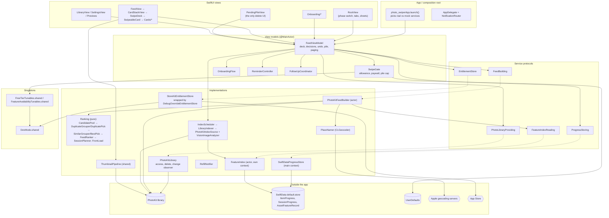

# JUN-5 Code Audit — Bristle (photo-cleaner)

*Read-only audit of `photo-cleaner` at branch `update-domains` (`706108e`, which is `main` @ `b1b0005` plus one commit that changes `.mcp.json` and `AppInfo.swift`). Audited 2026-11-08. No code was changed.*

**How to read this.** Every finding has an ID (`S-` security/privacy, `Q-` quality/scalability, `A-` agent workflow), a severity (`Critical` / `High` / `Medium` / `Low` / `Nit`), an effort (`S` / `M` / `L`) and, where it isn't obvious, a confidence. Line numbers are for the audited commit.

**Important limitation.** The audit ran in a Linux environment with no Xcode, so nothing was built, run or tested. Every finding comes from reading the code. Performance numbers are estimates. See [What I couldn't verify](#what-i-couldnt-verify--didnt-examine).

---

## 1. Executive summary

- **The codebase is in better shape than "built mostly by agents, barely reviewed" suggests.** It has clear protocol seams, a pure, well-tested ranking core (~430 Swift Testing tests plus 56 UI tests), no third-party dependencies, no secrets, release-safe debug gating, and careful comments that explain the *why*.
- **Your "few security issues because it's on-device" assumption mostly holds, with one real exception.** The app sends each photo's **exact GPS coordinates to Apple's reverse-geocoding service** (`CLGeocoder`) to caption cards with place names. The app's own copy says "Nothing is uploaded" and "never uploaded" (**S-2, High**).
- **Deletion is well guarded.** It takes a swipe into a pending pile, then an in-app "Delete N photos?" alert, then iOS's own confirmation, and photos land in Recently Deleted for 30 days. Nothing is ever deleted straight from a swipe.
- **There is one state bug that can file the wrong photos into the pile (S-1, High).** When a swipe refill lands, `FrontLoad` reorders the deck, which can replace the top card. The feed then applies the user's swipe, or their one-by-one review, to whatever card is on top now, not the one they looked at. The three confirmations above still stand between this and an actual delete.
- **Limited photo access is treated as "deleted elsewhere" (S-3, Medium).** Items outside the user's selection are settled as `gone`. Pile items vanish without being deleted and never come back to the feed.
- **There is no SwiftData schema versioning (S-4, Medium).** A future model change that SwiftData can't migrate automatically will silently drop users onto an in-memory store, and their progress will look wiped.
- **Scalability risk: every page of ~20 cards re-scans the whole library and index.** That includes loading feature prints for most photos (estimated 60–100 MB per page build at 50k photos). The algorithms are good (no O(n²)); it's the repeated full rebuild that costs (**Q-1, High, medium confidence**). Measure it with the existing `feed` log line before refactoring.
- **PR #16 (JUN-21) landed cleanly.** No half-migrated state: each concern has one owner and views only go through the façade. It left `FeedViewModel` as a 1,117-line façade with 30 forwarders and 23 members opened up to `internal` for the extensions (**Q-3, Medium**).
- **Agent readiness is the weakest area.** The app repo has no `CLAUDE.md`/`AGENTS.md`/`ARCHITECTURE.md`, no build/test/lint scripts, no lint config and no CI. Drafts are in `docs/audit/drafts/`.

**Health grades**

| Part | Grade | One-line reason |
|---|---|---|
| 1 — Security, privacy & dangerous design | **B** | Strong deletion design and zero third-party egress; held back by the geocoding disclosure gap and the wrong-card state bug. |
| 2 — Design, maintainability & efficiency | **B** | Clean layering and a testable core; the main risks are a large façade VM and the per-page full rebuild. |
| 3 — Agentic workflow readiness | **D** | Code comments are excellent agent context, but there are no instruction files, scripts, CI or guardrails yet. |

---

## 2. Codebase walkthrough ("how does my app actually work?")

### Stack (confirmed)

- **Language and UI:** Swift, SwiftUI, iOS 18.0+, iPhone only, portrait, light mode only. Swift **5** language mode. Strict concurrency is not enabled.
- **Apple frameworks:** PhotoKit (library and deletion), Vision (aesthetics score, utility flag, feature prints), Accelerate (sharpness and distances), SwiftData (persistence), StoreKit 2 (one non-consumable "unlock"), UserNotifications (refill reminders), CoreLocation (`CLGeocoder` only), AVKit (video).
- **Dependencies:** none. No Swift packages, no CocoaPods.
- **Project:** `photo-swiper/photo-swiper.xcodeproj`, one shared scheme `photo-swiper` with three targets: app, `photo-swiperTests` (Swift Testing) and `photo-swiperUITests` (XCTest). Synchronized folders, so files on disk are the project. The display name comes from `AppName.xcconfig` (`APP_DISPLAY_NAME = Bristle`).
- **Naming:** the repo is `photo-cleaner`, the Xcode project is `photo-swiper`, the module is `photo_swiper`, the bundle ID is `com.israelavendanojr.photo-swiper`, and the product is "Bristle".

### The big picture

The app is **MVVM with a services layer**. One `@Observable @MainActor` view model, `FeedViewModel`, is injected into the SwiftUI environment at launch. It owns the deck and delegates four side concerns to collaborators it owns. Everything that touches the system (PhotoKit, SwiftData, StoreKit, Vision) sits behind a protocol, with a real implementation and a mock. Ranking and grouping are **pure structs** you can test without PhotoKit.



### End-to-end: photo library → analysis → UI → deletion

1. **Launch.** `photo_swiperApp.launch()` builds `FeedViewModel.real(...)`. That means `PhotoKitLibrary`, one SwiftData container shared by progress (`SwiftDataProgressStore`) and the feature index (`FeatureIndex`), a `LibraryIndexer` wrapped by an `IndexScheduler`, and StoreKit. Debug builds read launch arguments (`-mockLibrary`, `-startAt …`) to swap in mocks. Release builds compile the mocks out.
2. **Onboarding and access.** `RootView.task` calls `vm.start()`. On first launch, `OnboardingFlow` shows Welcome and the photo-access primer *before* the system prompt. `PhotoKitLibrary.requestAccess()` asks for `.readWrite`, maps the answer to `full` / `limited` / `denied`, and starts the change observer.
3. **Background analysis (the index).** `IndexScheduler.accessGranted()` starts `LibraryIndexer.run()`. It runs only in the foreground, outside Low Power Mode, and while the device is cool. The indexer diffs the library against stored `AssetFeatureRecord`s and processes the new and edited items, newest first, in batches of 50. For each photo it gets a 512 px image already on the device (never downloaded) and computes sharpness, exposure, a 64-bit difference hash, Vision's aesthetics score and utility flag, and a feature-print vector. Then it saves. Because the work queue is rebuilt from that diff each time, runs are resumable with no cursor to keep.
4. **Building a page of cards.** `FeedViewModel` asks `FeedBuilding.makeSession` for about 20 items whenever 5 or fewer undecided cards remain. `PhotoKitFeedBuilder`:
   - lists the whole library, then builds the candidate pool with `CandidatePool`: every indexed undecided item, plus the newest 500 unindexed ones read live;
   - finds exact duplicates with `DuplicateGrouper`. It buckets hashes into four bands, so no O(n²) comparison, then checks aspect ratio and feature-print distance;
   - finds similar shots with `SimilarGrouper`: bursts, or shots within 90 s that are within 0.45 of the group's first shot;
   - picks keepers with `BestPick` / `DuplicatePick`;
   - scores everything with `FeedRanker` and takes the top 20 with `SessionPlanner`, batching screenshots by week;
   - fetches place names for captions through `PlaceNamer`, with a 1.5 s budget.
5. **The feed UI.** `CardStackView` hands `vm.cards` and `vm.index` to `SwipeDeck`, a reusable stack. Swipe left means delete, right means keep, up means later. Bundle cards (similar, duplicate, screenshot batch) clear "all but the keeper" or open a one-by-one review. `ThumbnailPipeline` pre-caches the next six cards at display size.
6. **A decision.** `vm.decide(direction)` checks the free allowance and pile cap (`SwipeGate`) and computes per-item decisions. It pushes an undo snapshot, writes the decisions through to SwiftData immediately (so force-quitting loses nothing), advances `index`, saves the deck, and builds the next page if needed. **Nothing touches the photo library here.**
7. **Deletion.** Items decided "delete" collect in the **pending pile**. The only path to PhotoKit deletion is `PendingPileView`: the user taps Delete, sees an in-app alert ("Delete N photos? … Recently Deleted for 30 days"), and then `vm.deleteNow` calls `PhotoKitLibrary.delete`. That runs `PHAssetChangeRequest.deleteAssets` inside `performChanges`, which **shows iOS's own confirmation**. The outcome is split into deleted, missing and undeletable, and each item is "settled" in the store.
8. **Library changes.** `PhotoKitLibrary` observes `PHPhotoLibrary` changes. When items disappear, they're settled as `gone`, pruned from upcoming cards, and their index records are removed.
9. **Monetization.** Free users get a swipe allowance that refills every 6 hours and a 1 GB pile cap. One StoreKit 2 non-consumable unlocks everything. Developer mode (Admin Tools) exists in Debug and TestFlight only, gated by a verified `AppTransaction`.

### Where state lives

| State | Owner | Persisted where |
|---|---|---|
| Deck, index, in-session decisions, marks, drafts, undo history | `FeedViewModel` | `SessionProgress` row (JSON snapshot), saved on every change |
| Per-item decisions and settlement | `ProgressStoring` | `ItemProgress` (SwiftData, one row per asset) |
| Analysis features and prints | `FeatureIndex` | `AssetFeatureRecord` (same SwiftData file) |
| Allowance, paywall state, pile cap | `SwipeGate` | UserDefaults (`swipeAllowance` JSON) |
| Onboarding step | `OnboardingFlow` | UserDefaults (`hasOnboarded`) |
| Reminders | `ReminderController` / `RefillNotifier` | UserDefaults + pending local notifications |
| Unlock | `StoreKitEntitlementStore` | StoreKit (cached in UserDefaults for launch) |
| Dev tunables | `DevMode` / `FreeTierTunables` / `FeatureAvailabilityTunables` singletons | UserDefaults, ignored outside Developer mode |

---

## 3. Part 1 — Security, privacy & dangerous design

### Checklist results (every item, clean or not)

| # | Area | Result |
|---|---|---|
| 1 | **Data egress** | **One finding (S-2).** No `URLSession`, analytics, crash reporter, remote config or third-party SDK anywhere. The network is reached only through Apple frameworks: `CLGeocoder` (sends coordinates to Apple, **S-2**); PhotoKit iCloud *downloads* for thumbnails and video (`isNetworkAccessAllowed = true` in `ThumbnailPipeline.swift:22` and `VideoSource.swift:22`; downloads, not uploads); StoreKit and `AppTransaction`; `SFSafariViewController` for the privacy and support pages; and a `mailto:` support link whose body has only the app version, iOS version and device model (`SupportMail.swift:27-37`). The indexer explicitly never downloads (`PhotoKitIndexSource.swift:164`). |
| 2 | **Destructive operations** | **Well designed, with one state bug (S-1) and one limited-access issue (S-3).** Deletes always go through the pile, then an in-app alert (`PendingPileView.swift:84-89`), then the iOS system prompt (`PhotoKitLibrary.swift:58-60`). They're reversible (Recently Deleted) and batched as a single all-or-nothing request. Only items in the pile can be deleted (`FeedViewModel.swift:631-632`). Undo history is cleared after a real delete (`:637`). Library changes mid-session prune upcoming cards but not the current one (`:938-951`). Analysis and deletion don't race destructively: the indexer only reads, and removed IDs are dropped from the index through the change stream (`IndexScheduler.swift:281-284`). |
| 3 | **Permissions** | **OK, minor gaps (S-10).** Requests `.readWrite`, the minimum that allows deletion. Handles full, limited and denied. Revocation kills the app (iOS behavior), and the next launch shows `LibraryAccessView`. Only `NSPhotoLibraryUsageDescription` is declared, which is correct. No location, camera or add-only keys. **But the usage string says "Nothing is uploaded"** (see S-2). Limited access is mis-modelled (S-3). |
| 4 | **Local storage** | **Low (S-5).** One SwiftData file in Application Support holds decisions with item metadata (dates, place names, sizes, flags, features) and the feature index (feature prints use `.externalStorage`). Default file protection. Included in device and iCloud backups. No temp files, no image caches on disk (thumbnails live in `PHCachingImageManager` memory). Records are cleaned up when assets leave the library (`LibraryIndexer.swift:67-69`). |
| 5 | **Secrets & config** | **Clean.** No keys or tokens in the repo or its history (checked for `.env`, `.p8`/`.p12` and key patterns). No entitlements file, so no extra capabilities. Debug launch arguments are `#if DEBUG`. Mocks are excluded from Release (`EXCLUDED_SOURCE_FILE_NAMES`, `#if DEBUG`). `DebugEntitlementStore` can't unlock in Release. Developer mode needs a verified `AppTransaction` that isn't production (`DevMode.swift:29-46`), so App Store builds never get the unlock override or tunables. `ITSAppUsesNonExemptEncryption = false` is correct. |
| 6 | **Dependencies** | **Clean: zero third-party dependencies in the app.** Dev tooling only: `.mcp.json` runs `npx -y xcodebuildmcp@latest`, which is unpinned (**A-4**). |
| 7 | **Crash & robustness** | **Clean in production paths.** All `!` and `as!` are on constants, mock data or `layerClass` (`AppInfo.swift:19`, `VideoPreviewView.swift:453`, `Services/Mock/*`). `SimilarGroup.best` / `DuplicateGroup.keep` fall back to `items[0]`, which is safe because pruning guarantees two or more items (Nit, Q-9). Library scans run off the main thread (actors). Images are requested at display size, capped at 1,600 px, and only a six-card window is pre-cached. One low-confidence continuation and cancellation race (S-8). |
| 8 | **Logging** | **Clean.** Release logs are counts and timings only. Interpolated errors use OSLog's default private redaction. Asset identifiers are logged `.public` only in the `#if DEBUG` similarity log (`PhotoKitFeedBuilder.swift:209-230`). No file names, locations or place names are logged. |

### Findings

| ID | Title | Sev. | Effort | Location | Explanation | Recommended fix |
|---|---|---|---|---|---|---|
| **S-1** | A swipe or review can be applied to a different card than the one the user acted on | **High** (mitigated; conf. medium-high, not reproduced on device) | S | `Views/Feed/CardStackView.swift:60-71`; `ViewModels/FeedViewModel.swift:529-555, 688-690, 699-706, 720-731`; `Services/Ranking/FrontLoad.swift:13-38`; `Views/Feed/FeedView.swift:34-39`; `Views/RootView.swift:46-49`; `Views/Feed/SwipeDeck.swift:170-174` | `SwipeDeck` reports *which* card left (`onDecide(direction, card)`), but `CardStackView.decide` ignores `card` and calls `vm.decide(direction)` / `vm.decideIndividually(outcome)`. Those act on **`vm.currentCard` at that moment**. Meanwhile `refreshAllowance()` → `frontLoad()` calls `FrontLoad.reordered(cards, from: index)`, which can move a similar, duplicate or large-video card **into the current position**. It fires from a timer the moment a refill is due (`FeedView.task(id: nextRefillAt)`), on return to the foreground, and *inside* `decide()` itself via `admitSwipe()`, after the card was read. Concrete case: the user opens a single photo full screen (or a screenshot batch's one-by-one review). A refill lands. A similar-shots set becomes the top card. The user swipes left in the preview, and **the similar set's non-best shots go to the pile instead**. A finished batch review's outcome falls through `completed()` to the new card's default marks, which are also "delete all but best". Side effects: the skipped card ends up behind `index` undecided, and undo restores to the wrong card. Mitigations that keep this from being Critical: nothing is deleted without the pile, the in-app alert and the iOS confirmation, and Recently Deleted keeps it for 30 days. But the pile pre-selects everything, so a trusting user could confirm. | (1) Pass the card through: `vm.decide(direction, cardID:)` and `vm.decideIndividually(outcome, cardID:)`, and **no-op if `currentCard?.id != cardID`**. (2) Make `FrontLoad` never move the card at `index` (reorder from `index + 1`), or defer front-loading while a preview or review is open. (3) In `decide()`, read `currentCard` *after* `admitSwipe()`. Add the regression test listed under Part 2 §8. |
| **S-2** | Exact photo GPS coordinates are sent to Apple's geocoder, contradicting "Nothing is uploaded" | **High** (privacy disclosure; conf. high) | S–M | `Services/PhotoKit/PlaceNamer.swift:40-46`; `Services/PhotoKit/PhotoKitFeedBuilder.swift:67-71`; usage string in `project.pbxproj:409,442`; `Views/Settings/SettingsView.swift:216`; website `content/privacy.mdx` | For each card, `asset.location` (the photo's EXIF GPS) goes to `CLGeocoder.reverseGeocodeLocation`, which is a network call to Apple. Cells are cached at about 1 km, but **the exact coordinate is what gets sent**. It happens up to every page, for up to 20 photos. This is Apple first-party and not linked to an account by the app, so it's not a "breach". But it is location data about the user's photos leaving the device, and three places promise otherwise: the permission prompt ("Nothing is uploaded"), Settings ("never uploaded"), and the draft privacy policy. App Store privacy labels and review also look at exactly this claim. | Pick one: **(a)** keep it, but disclose it in the privacy policy and soften the copy ("Photos never leave your iPhone. Place names are looked up with Apple."); **(b)** make place names an opt-in Settings toggle, off by default; or **(c)** drop place names, or use only on-device data. Whichever you pick, **send the cell center, not the exact coordinate**, since you already compute `Cell`. Add the privacy-policy wording to the launch checklist. |
| **S-3** | Limited access (or a narrowed selection) is treated as "deleted outside the app" | **Medium** (conf. high) | M | `Services/PhotoKit/PhotoKitLibrary.swift:42-53, 79-86, 124-139`; `ViewModels/FeedViewModel.swift:908-910, 938-944, 1002-1013`; `Services/Persistence/SwiftDataProgressStore.swift:98-106` | Under `.limited`, `PHAsset.fetchAssets(withLocalIdentifiers:)` returns only selected assets. So `missing(from:)` at restore, `delete()`'s `missing` list, and the change observer when the selection shrinks all report unselected items as gone. Those decisions get `settlement = .gone`. Pile items **leave the pile without being deleted**. "Reviewed" counts drop. And because `excludedFromNewSession` excludes every non-"later" decision whatever its settlement, those photos **never return to the feed**, even after full access is granted. iOS kills the app when access is downgraded, so the restore path is hit on the next launch. Also: `LibraryIndexer.run` deletes index records for every unselected asset (`LibraryIndexer.swift:67-69`), so going back to full access re-indexes the whole library. | Only settle as `gone` when `PHPhotoLibrary.authorizationStatus(for: .readWrite) == .authorized`. Under limited, leave the records open and just hide them from the deck and pile, or add an "outOfScope" state. Skip index pruning under limited access. Add tests with a mock library that reports `.limited` (see Part 2 §8). |
| **S-4** | No SwiftData schema versioning; a failed migration silently resets the user's progress | **Medium** | M | `photo_swiperApp.swift:94-103`; `Services/Persistence/ProgressModels.swift`; `Services/Index/AssetFeatureRecord.swift`; `SwiftDataProgressStore.swift:27-30` | The container is built from bare `@Model` types with no `VersionedSchema` or `SchemaMigrationPlan`. Additive optional fields migrate fine, and the code is careful about that today. But any rename, type change or non-optional addition throws at `makeContainer`. Release then falls back to `InMemoryProgressStore` with no index and no user-visible signal (`assertionFailure` is a no-op in Release). The pile and all decisions *look* wiped, and every launch re-indexes nothing. No photos are lost. | Define `SchemaV1` (today's models) and a `MigrationPlan` now, while it's free. Add a test that opens a checked-in V1 store fixture. In Release, report the open failure to the user ("Couldn't load your progress") instead of silently degrading. Consider separate containers for progress (precious) and index (re-derivable). |
| S-5 | Progress and feature index are included in backups | Low | S | `SwiftDataProgressStore.swift:28` (default URL) | Application Support is backed up to iCloud and to computers. The store holds per-photo metadata, place names and feature vectors for the whole library. Because `localIdentifier`s don't carry over to a new device, the backup is of little use and only enlarges the data footprint. | Put the index in its own store under Caches, or set `isExcludedFromBackup`. Decide deliberately whether progress should back up. |
| S-6 | Undocumented `PHAssetResource` KVC key `fileSize` | Low (conf. medium) | — | `Services/PhotoKit/FileSizeReader.swift:17` | It's widely used by cleaner apps and has a fallback, but it's private API by KVC. It could break in an iOS update or draw a review question. | Keep the fallback. Add a test that fails loudly if the key stops resolving on a real device. Note it for App Review. |
| S-7 | Copy says scanning continues "in the background"; the indexer is foreground-only | Nit | S | `Views/Onboarding/PhotoAccessPrimerView.swift:136`; `Services/Index/IndexScheduler.swift:255` | Users may expect progress while the app is closed. | Reword ("keeps scanning while you swipe"), or add a `BGProcessingTask` later. |
| S-8 | `VideoSource` request-ID box is racy; possible continuation leak on cancel | Low (conf. low) | S | `Services/VideoSource.swift:25-40` | `RequestBox.id` is written in the continuation and read in `onCancel` with no lock. If `requestPlayerItem`'s handler isn't called after cancellation, the continuation never resumes. | Guard with a lock, the same pattern as `Once`. Resume on cancel through a once-only flag. |
| S-9 | StoreKit unlock state is cached in UserDefaults for launch | Nit | — | `StoreKitEntitlementStore.swift:38,142-145` | Trusted until `currentEntitlements` corrects it a moment later. Only exploitable on a jailbroken device. Acceptable. | None needed. |
| S-10 | Limited-access UX gaps | Low | S | `Views/Library/LibraryView.swift:138-148`; Info.plist | There's no `PHPhotoLibrary.presentLimitedLibraryPicker`; the only path is the Settings app. There's no `PHPhotoLibraryPreventAutomaticLimitedAccessAlert`, so iOS may nag on each launch. | Add an "Add more photos" button that opens the limited picker, and the plist key. Do this together with S-3. |

---

## 4. Part 2 — Design, maintainability & efficiency

### Is this structure easy to maintain and extend as features get added?

**Mostly yes, with one pressure point.** New *analysis signals* and *card types* are easy to add. The pipeline is a chain of pure, injected stages, `FeedCard` is a closed enum the compiler checks exhaustively, and tests cover each stage. New *services* are easy too, because protocols with mocks already exist. The pressure point is **`FeedViewModel`**. Every new feature still adds members to one 1,117-line `@MainActor` class that every view reads from the environment. Debug and admin features reach into its internals through widened access. Second, the **page build does a full library and index pass every time**. That's fine for 5k photos and is the first thing that will hurt at 50k.

### 4.1 Architecture map

See the diagram in §2. **Pattern:** MVVM (one coordinator VM plus four collaborators) over a protocol-backed services layer, with a functional core (Ranking, Analysis) and an imperative shell (PhotoKit, SwiftData, Vision). **Consistency:** good. Views never touch PhotoKit or SwiftData directly; the exceptions are `ThumbnailPipeline` (deliberate) and `ItemImage`. No view reaches a collaborator directly: all 4 `vm.onboarding…` uses go through forwarders. Business logic lives in models and services, not views.

### 4.2 Boundaries & coupling

- **Views doing business logic:** essentially none. `PendingPileView` holds selection state (UI state, fine). `CardStackView.decide` contains the S-1 bug, but it only routes.
- **The 10 largest files** (lines): `FeedViewModel.swift` 1,117 · `SettingsView.swift` 522 · `VideoPreviewView.swift` 461 · `OnboardingView.swift` 366 · `PendingPileView.swift` 356 · `SwipeableCard.swift` 334 · `Zoomable.swift` 273 · `PhotoKitFeedBuilder.swift` 255 · `PhotoAccessPrimerView.swift` 250 · `SwiftDataProgressStore.swift` 248. Only the first is a concern. The views are long because of styling, not logic.
- **The 10 largest functions** (lines): `SettingsView.body` 120 · `RootView.body` 107 · `SwipeDeck.body` 84 · `FeedViewModel.mock` 66 · `SessionPlanner.plan` 61 · `PendingPileView.body` 60 · `VideoPreviewView.body` 58 · `PhotoKitFeedBuilder.makeSession` 58 · `DHash.hash` 57 · `LibraryIndexer.run` 52. `RootView.body` carries five sheets and four `.task`s for presentation logic. That's a candidate for a small `PresentationCoordinator`.
- **Singletons and global state:** `DevMode.shared`, `FreeTierTunables.shared`, `FeatureAvailabilityTunables.shared`, `ThumbnailPipeline.shared` and `NotificationRouter.shared`. All are injectable except `DevMode.shared`, which is read directly from `SettingsView` and wired as a default into `DebugOverrideEntitlementStore` and `FreeTierTunables`. Acceptable for dev-only state.
- **Circular dependencies:** one at the type level. `SwipeGate`, `OnboardingFlow` and the others use `typealias … = FeedViewModel.PaywallStatus/Phase/OnboardingStep`, so collaborators depend on the class that owns them (Q-3).
- **Testability of core logic:** **similarity, duplicates, scoring, planning and front-loading are pure and unit-tested. Deletion planning (`FeedViewModel` with `MockPhotoLibrary`) is tested.** Not testable today: `PhotoKitFeedBuilder.makeSession`, which fetches PHAssets inline, and `PhotoKitLibrary`'s outcome mapping (Q-4).

### 4.3 Abstraction — too much or too little?

- **Too little (add a seam):**
  - an `AssetCatalog`-style protocol for "enumerate library / fetch by IDs / asset → features" used by `PhotoKitFeedBuilder`, `PhotoKitLibrary.delete/missing`, `VideoSource` and `ThumbnailPipeline`;
  - a `PlaceNaming` protocol, so S-2's policy is in one place and can be switched off in tests;
  - an **authorization-aware** library state for S-3.
- **Too much:** nothing significant. Protocols with one production implementation (`FeedBuilding`, `ProgressStoring`, `FeatureIndexReading`, `IndexAssetSource`, `ImageAnalyzing`) each have a mock or test fake, so they earn their keep. `DebugOverrideEntitlementStore` wraps StoreKit in Release too, but it's a no-op there and keeps one code path. Fine.

### 4.4 Duplication

| Duplicate | Call sites | Proposed shared piece |
|---|---|---|
| Fetch-by-identifiers then enumerate into a dict or array | `PhotoKitLibrary.swift:45,82`; `PhotoKitFeedBuilder.swift:64,134`; `PhotoKitIndexSource.swift:192,199`; `ThumbnailPipeline.swift:90`; `VideoSource.swift:15` | `PHAsset.byID(_ ids:) -> [String: PHAsset]` extension, or the `AssetCatalog` seam (§4.3) |
| `balancedChunks` and oldest-first `sorted` | `SimilarGrouper.swift:126-145`; `DuplicateGrouper.swift:284-303` | `GroupingUtil.balancedChunks(_:max:)` and `RankCandidate.oldestFirst` |
| `similarID` / `duplicateID` (SHA-256 of sorted IDs) | `PhotoKitFeedBuilder.swift:233-242` | `stableGroupID(prefix:ids:)` |
| `SimilarGroup` vs `DuplicateGroup` (same shape: items, keeper ID, reason, `others`) and the parallel switch arms | `Models/FeedCard.swift:56-80`; `FeedViewModel.swift:344-360, 846-849, 869-874, 1091-1098` | `protocol KeeperGroup { items; keeperID; reason }` with shared `others` / `marked` / `removing` |
| Near-identical card views | `Views/Cards/SimilarShotsCardView.swift` (189) and `DuplicatesCardView.swift` (154) | One `KeeperGroupCardView` that takes header copy and chip text |
| Two designated `FeedViewModel` inits repeat collaborator wiring | `FeedViewModel.swift:162-194, 197-230` | Have the preview init call the main init, then `apply(session)` |
| "Open iOS Settings" button | `SettingsView.swift:47`; `LibraryView.swift:143`; `LibraryAccessView.swift:27` | `OpenSettingsButton` or an `openSystemSettings()` env helper |
| OSLog subsystem string literal | 7 files | `Logger.app(category:)` with one subsystem constant |

### 4.5 Performance & efficiency

| Check | Result |
|---|---|
| Image loading and thumbnail sizing | **Good.** Requests at view pixel size, bucketed to 128 px, capped at 1,600 px; opportunistic delivery; a six-card pre-cache window; cache dropped on memory warning (`ThumbnailPipeline.swift`). |
| Caching strategy | Good for pixels. **Missing for page builds** (Q-1). |
| Redundant fetches and recomputation | **Q-1.** Each page re-enumerates the library, materializes every index record (`FeatureIndex.indexed()`), and re-groups everything to keep about 20 items. |
| O(n²) comparisons | **None.** Similar grouping is windowed by time (90 s gap, 5 min span, 8 max). Duplicate detection uses LSH-style hash banding with a bucket cap. `makeGroup` is O(k²) for k ≤ 8–10. |
| Main-thread work | Indexing, page builds and deletes run off main. **On main:** SwiftData progress writes (two saves per swipe plus a full deck JSON re-encode), `reviewedCount()` with no index, `excludedFromNewSession` (all rows) per page, and a single-ID `PHAsset` fetch per new card (Q-2, Q-10). |
| Memory spikes on 50k+ libraries | **Q-1:** feature prints for every time-neighbor photo per page (≈3 KB each), plus all index records as SwiftData objects. |
| SwiftUI re-renders | Fine. `@Observable` tracks per property. `pendingItems` is recomputed on each read (O(deck)) and read several times per `PendingPileView` render. Cheap at deck sizes. |

### 4.6 State management — PR #16 (JUN-21) verification

**Verdict: landed cleanly, with no half-migrated state.** `FeedViewModel` went from 1,560 to 1,117 lines. `SwipeGate` (allowance, paywall, pile cap), `OnboardingFlow`, `ReminderController` and `FollowUpCoordinator` each **solely own** their state. `FeedViewModel` keeps no shadow copies; it forwards. Collaborators never reach each other, and cross-cutting effects are sequenced in the VM, as the doc comment says. Views go only through the façade. Admin and mock code moved to extensions with `#if DEBUG` where needed.

**Leftovers (Q-3):**
- 30 pure forwarding members.
- **23 members marked `// internal for FeedViewModel+AdminTools` (or `+Mock`)**. These include *settable* `session`, `index`, `settledIDs`, `returningCard` and `hasCelebratedComplete`, which any view holding `vm` could now mutate. No view does today; I checked.
- Nested enums that collaborators alias back to.
- Duplicated inits.
- `SavedSession.finished` (documented legacy, fine).
- Stale branches `JUN-21` (remote and local) and three `worktree-agent-*` branches.

**Single source of truth:** yes for each concern. **Consistency across features:** yes. Settings, Library, Pile and Feed all read the same environment VM.

### 4.7 Consistency & hygiene

- **Naming:** consistent, descriptive Swift naming. Identity is inconsistent across repo, project, module, bundle and product (Q-8).
- **Folder structure:** clear (`Models / Services/{Analysis,Index,Ranking,PhotoKit,Persistence,Entitlements,Allowance,Mock} / ViewModels / Views/{Feed,Cards,Session,…} / DesignSystem`).
- **Error handling:** consistent strategy of "log and degrade". Errors are swallowed on purpose with comments (`try?` in persistence decode paths). The risky swallow is S-4.
- **Dead code and unused assets:** none found beyond `SavedSession.finished`. Mock assets are excluded from Release.
- **TODO/FIXME:** one, `AppInfo.swift:24` (`appStoreID` for launch).
- **Compiler warnings:** **not checked** (no Xcode).
- **Linting/formatting:** **none configured** (no SwiftLint, no swift-format/SwiftFormat).

### 4.8 Tests & CI

- **Covered (strong):** about 430 Swift Testing cases across 30 files: duplicates, pile cap, ranker, allowance, onboarding gating, persistence round-trips, StoreKit store, similar grouping, indexer (with fakes), deletion outcomes through `MockPhotoLibrary` (cancel, fail, partial, external delete), undo and drafts. Plus 56 UI tests on the mock library. `LaunchGuardTests` fails Release runs while launch URLs are unset. A nice touch.
- **Not covered:** card identity in decisions (S-1), limited access (S-3), schema migration (S-4), `PhotoKitLibrary`/`PhotoKitFeedBuilder` (no seam), `PlaceNamer`, page-build performance at scale.
- **CI:** **none** (no `.github/`, no Xcode Cloud config in repo).

**Five highest-value tests to add first**

1. **Decision binds to the acted-on card.** Start a mock deck with `[photo, photo, similar]` and swipes below the cap. Advance the injected clock past `refillInterval`, call `refreshAllowance()`, then `decide(.left, cardID: originalTop)`. Expect only the original photo in the pile, and expect the similar set still undecided. Covers S-1.
2. **Limited access never settles as gone.** `MockPhotoLibrary(access: .limited)` reports pile items as missing. After `restore` / `deleteNow` / a vanished event, expect them still pending and not excluded later. Covers S-3.
3. **Store migration fixture.** Open a checked-in V1 `default.store` with the current schema and expect the decisions to be readable. Covers S-4.
4. **Deletion outcome mapping.** A pure `DeletionOutcome.make(requested:found:deletable:)` (extracted from `PhotoKitLibrary.delete`) with mixed found, missing and undeletable inputs. This is the last untested step before real deletion.
5. **Page-build scaling.** Run `DuplicateGrouper`, `SimilarGrouper` and `SessionPlanner` on 50k synthetic candidates and prints, under a time and memory budget (Swift Testing `.timeLimit`, or XCTest `measure` with `XCTMemoryMetric`). This guards Q-1 and catches an accidental O(n²) later.

### Findings

| ID | Title | Sev. | Effort | Location | Explanation | Recommended fix |
|---|---|---|---|---|---|---|
| **Q-1** | Every page rebuilds from the whole library and index (memory and latency at 50k+) | **High** (conf. medium; estimate) | M–L | `PhotoKitFeedBuilder.swift:51-56, 122-142, 162-207`; `FeatureIndex.swift:21-34, 43-55` | About every 20 cards: `PHAsset.fetchAssets` enumerates the full library; `indexed()` materializes every record; `SimilarGrouper.neighborIDs` typically marks a large share of photos (anything within 90 s of another); and `featurePrints(for:)` loads all of them. At 50k photos with roughly half as neighbors, that's about 25k × 3 KB ≈ 75 MB of `Data` plus a `[Float]` copy, plus SQLite reads, **per page**, to emit about 20 items. Groups barely change between pages. | **Measure first.** The `feed` log already prints `printCount` and seconds. Then: cache grouping results in the builder, keyed by an index generation counter that `upsert`/`remove` bump, and recompute only when it changes; or compute groups in the indexer and store `groupID`; or bound the candidate pool by recency windows. Add the scaling test (§4.8 #5). |
| Q-2 | Per-swipe persistence on the main thread | Medium | M | `FeedViewModel.swift:736-762, 1038-1051`; `SwiftDataProgressStore.swift:49-75, 108-121, 155-181`; `ProgressModels.swift` | Each swipe: `store.save` saves, `saveSession` re-encodes the whole deck (~90 cards with features) to JSON and saves again, and `refreshTotals` runs `fetchCount` with a predicate on non-indexed columns. That's fine at 5k rows and becomes a hitch at 50k on older phones. | Add `#Index<ItemProgress>([\.decisionRaw], [\.settlementRaw])` (iOS 18). Keep `reviewedCount` incrementally. Coalesce the two saves into one. Debounce `saveSession` (decisions stay write-through, so force-quit safety holds). |
| Q-3 | PR #16 leftovers: façade size, widened access, type cycle | Medium | M | `FeedViewModel.swift` (23 members marked `internal for …`, mostly :79-140); `SwipeGate.swift:10`; `OnboardingFlow.swift:10-11` | See §4.6. Widened settable state undoes part of the encapsulation the refactor bought. | Make widened properties `private(set)`, and give the extensions narrow `internal func`s. Move Admin Tools into an `AdminController` that receives the VM's intents. Hoist `Phase`, `PaywallStatus` and `OnboardingStep` to top-level types. Collapse the duplicate init. Delete the merged `JUN-21` and `worktree-agent-*` branches. |
| Q-4 | No seam over PhotoKit in the feed builder and library | Medium | M | `PhotoKitFeedBuilder.swift:62-75, 122-142`; `PhotoKitLibrary.swift:42-66` | Session assembly (IDs → items, place names, group IDs) and delete-outcome mapping can only run on a real library. | Add an `AssetCatalog` protocol and a `PlaceNaming` protocol, and extract `DeletionOutcome.make`. Unit-test them. |
| Q-5 | Swift 5 mode, no strict concurrency checking | Medium | M–L | `project.pbxproj` (`SWIFT_VERSION = 5.0`); `@unchecked Sendable` in `PhotoKitLibrary`, `PhotoKitIndexSource`, `AnalysisImage`, `AnalysisCost`, `Once`, `VideoSource.RequestBox`; `nonisolated(unsafe)` in `StoreKitEntitlementStore:31`; `FeatureIndex` uses `ModelContext` in a plain actor | The code is concurrency-heavy (actors, PhotoKit callbacks, Vision) and compiles without data-race diagnostics. Most unchecked uses are correctly locked; S-8 isn't. | On a branch, set `SWIFT_STRICT_CONCURRENCY = complete` and fix the warnings, then move to Swift 6 mode. Make `FeatureIndex` a `@ModelActor`. |
| Q-6 | Duplication | Low | S–M | See §4.4 | Small individually; the keeper-group duplication will grow with each new bundle type. | See §4.4. |
| Q-7 | No lint/format config, no CI | Low | S | repo root | Agent-written code drifts in style; nothing runs tests on PRs. | Add SwiftFormat + SwiftLint (minimal rules) and a GitHub Actions macOS job: build plus unit tests (see A-2). |
| Q-8 | Identity sprawl and stale branches | Low | S | repo, project, scheme, branches | `photo-cleaner` / `photo-swiper` / `photo_swiper` / Bristle confuses agents. There are 3 `worktree-agent-*` branches at `#14` and several merged feature branches. | Document the names in `CLAUDE.md` (the bundle ID is permanent). Rename the scheme to `Bristle` if you like. Prune merged branches. |
| Q-9 | `items[0]` fallback on keeper lookup | Nit | S | `Models/FeedCard.swift:65,78` | Safe today because pruning keeps two or more items, but it would crash on an empty group from a future code path. | Return an optional, or assert non-empty at construction. |
| Q-10 | Synchronous single-asset fetch on main per new card | Low | S | `ThumbnailPipeline.swift:88-93` | About a millisecond per card; fine. It could batch in `preheat`. | Fetch the whole preheat window's assets in one `fetchAssets` call. |

---

## 5. Part 3 — Agentic workflow readiness

### Inventory

| Item | Found |
|---|---|
| `CLAUDE.md` / `AGENTS.md` (app repo) | **None** at the root or nested. The Lovable demo under `photo-swiper-context/` (gitignored) has an unrelated `AGENTS.md`. |
| `ARCHITECTURE.md`, module overview, ADRs | **None.** The best existing context is the doc comments, which are excellent: most types explain their *why*. The `README.md` is one line. |
| CLI feedback loop | **None scripted.** It's possible with raw `xcodebuild`, but there's no Makefile, script or documented simulator destination. Launch arguments for mocks are documented only in `photo_swiperApp.swift:28-38`. |
| MCP config | `.mcp.json`: **XcodeBuildMCP** via `npx -y xcodebuildmcp@latest` (added in the latest commit, unpinned). Linear is connected at the account level (this audit used it). No GitHub MCP; `gh` covers it. |
| `.claude/` | Only an empty `worktrees/`. No settings, skills, commands, subagents or hooks. |
| CI | None. |

### Findings

| ID | Title | Sev. | Effort | Location | Explanation | Recommended fix |
|---|---|---|---|---|---|---|
| **A-1** | No agent instruction or architecture files | **High** (for an agent-first workflow) | S | repo root | Every session re-derives the architecture, invariants (write-through persistence, pile-only deletion, `#if DEBUG` mocks) and build commands. That's how S-1-type regressions and style drift creep in. | Review and move `docs/audit/drafts/CLAUDE.md` and `ARCHITECTURE.md` to the root. Keep them under about 150 lines each. |
| A-2 | No self-verification loop (scripts, lint, CI) | Medium | S | repo root | An agent can't cheaply prove its change builds and passes tests. | Add a `Makefile` (sketch below) and a GitHub Actions job running `make build test-unit`. |
| A-3 | No guardrails on destructive and privacy paths | Medium | S | `.claude/` | Edits to `PhotoKitLibrary`, `PendingPileView`, `FeedViewModel.delete*`, `PlaceNamer` or `Info.plist` strings should always get a human review. | The privacy/destructive-op guard skill plus a hook (below), and a rule in `CLAUDE.md`. |
| A-4 | MCP server runs an unpinned `@latest` package | Low | S | `.mcp.json` | `npx -y …@latest` executes whatever is published that day, with your shell's permissions. | Pin the version (`xcodebuildmcp@<x.y.z>`) and bump it deliberately. |

### Recommended feedback-loop scripts (sketch)

```make
# Makefile (repo root) — the minimum an agent needs to verify its own work
PROJ   := photo-swiper/photo-swiper.xcodeproj
SCHEME := photo-swiper
DEST   ?= platform=iOS Simulator,name=iPhone 16   # pick one from: xcrun simctl list devices available
XCB    := xcodebuild -project $(PROJ) -scheme $(SCHEME) -destination '$(DEST)'

build:      ; $(XCB) build -quiet
test-unit:  ; $(XCB) test -quiet -only-testing:photo-swiperTests
test-ui:    ; $(XCB) test -quiet -only-testing:photo-swiperUITests
test:       test-unit test-ui
lint:       ; swiftformat --lint . && swiftlint --strict
format:     ; swiftformat .
verify:     lint build test-unit          # what an agent runs before saying "done"
```

### MCP toolkit — recommendation

| Server | Keep / add | What it's for here |
|---|---|---|
| **XcodeBuildMCP** | **Keep; pin the version** | Build, run tests, boot the simulator, launch with arguments (`-mockLibrary YES -startAt similar`), take screenshots. It's the most established Xcode/simulator MCP and fits this repo's mock-launch-argument design. Use the `Makefile` as the fallback. |
| **Linear** (account connector) | Keep | Read the issue context at the start of a task. Post a status comment at the end. Don't let agents change statuses without asking. |
| **GitHub** | Optional | `gh` CLI already covers PRs and reviews. Add the MCP only if you want inline review comments from agents. |
| **Apple docs lookup** | Optional | Useful for PhotoKit, SwiftData and Vision API changes. If you don't find a server you trust, `WebFetch` on developer.apple.com is enough. Not worth an unvetted package. |
| Playwright / next-devtools | Website repo only | Not relevant to the app repo. Keep them out of its `.mcp.json`. |

Nothing configured in the app repo is idle. XcodeBuildMCP just needs pinning.

### Skills, commands & hooks — proposed set

1. **`/new-feature` (skill).** *Use when* starting any feature or bugfix issue. It reads `CLAUDE.md`, `ARCHITECTURE.md` and the Linear issue. Then it writes a short plan in plan mode, naming the files, the protocol seams it will use and the tests it will add. It writes failing Swift Testing tests against the mock services, implements until `make verify` passes, and updates `ARCHITECTURE.md` in the same change if a module boundary or data flow moved.
2. **`/pre-pr` (skill or command).** *Use before* opening any PR. It runs `make verify`. It diffs against `main` and checks: no new `print`; no `.public` logging of identifiers outside `#if DEBUG`; mocks still `#if DEBUG`; no new network or `CLGeocoder` use; new persisted fields optional or migrated (S-4); new `@unchecked Sendable` justified. Then it drafts the PR description with a "Risk" section.
3. **`privacy-destructive-guard` (skill plus hook).** *Use whenever* a change touches deletion, permissions, persistence schema or anything that could send data off the device. The skill is a checklist: the pile is still the only path to `PHAssetChangeRequest.deleteAssets`; decisions bind to card IDs; there's an in-app confirmation before the system prompt; limited access is handled; the usage strings and privacy policy still match. Pair it with a `PreToolUse` hook on `Edit|Write` that warns (exit code 2 blocks) when the path matches `PhotoKitLibrary|PendingPileView|FeedViewModel|PlaceNamer|ProgressModels|AssetFeatureRecord|project.pbxproj`, telling the agent to load the guard skill and flag the PR for human review.
4. **`/linear-to-pr` (skill).** *Use when* the user says "take JUN-NN". It fetches the issue, creates `jun-NN-short-slug` from `main`, runs `/new-feature`, then `/pre-pr`, opens the PR with `gh` (title prefix `feat|bug|chore(scope):` to match your history), and comments the PR link on the Linear issue. No status changes without asking.
5. **Post-edit hook.** A `PostToolUse` hook on `Edit|Write` that runs `swiftformat` on just the edited `.swift` file (fast). Don't build on every edit, because it's too slow. Add a `Stop` hook that runs `make build` once per turn if any `.swift` file changed.

Sketch of the hooks (`.claude/settings.json`; verify against the current Claude Code docs before using):

```json
{
  "hooks": {
    "PostToolUse": [
      { "matcher": "Edit|Write",
        "hooks": [{ "type": "command", "command": "scripts/hooks/format-edited.sh" }] }
    ],
    "PreToolUse": [
      { "matcher": "Edit|Write",
        "hooks": [{ "type": "command", "command": "scripts/hooks/guard-sensitive-paths.sh" }] }
    ]
  }
}
```

### Workflow playbook

- **Plan mode vs direct edits.** Use plan mode for anything that touches more than one layer (view, VM and service), anything in deletion, permissions or persistence, and anything in `FeedViewModel`. Direct edits are fine for copy, styling, a single pure function with tests, and the DesignSystem.
- **Scoping tasks.** One Linear issue becomes one branch and one PR. Name the files or module in the task. Tell the agent which seam to use ("add a protocol in Services/, mock in Services/Mock"). Ask for tests first against mocks. Keep PRs under about 400 changed lines; PR #16's split into six commits is a good model.
- **Always require human review for:** deletion logic and the pile; anything that changes which card or items a decision applies to; permission requests and usage strings; SwiftData `@Model` changes and migrations; StoreKit and entitlement logic; any new network call or framework that can reach the network; privacy-policy-relevant copy.
- **Keeping docs from drifting.** Structural changes update `ARCHITECTURE.md` in the same PR, and `/pre-pr` checks for it. `CLAUDE.md` holds only rules and commands, not descriptions that go stale. Review both at each milestone (e.g. Beta). Delete rules that no longer apply.

---

## 6. Prioritized action plan

Each item is ready to paste as a Linear issue.

### Do now

1. **Bind swipe and review decisions to the card the user acted on** — *JUN-22 Security Risks*. `CardStackView.decide` ignores the card it's given, and `FrontLoad` can swap the top card when a refill lands, so a swipe or review can apply to a different card (S-1). Pass the card ID to `decide`/`decideIndividually` and no-op on mismatch; stop `FrontLoad` from moving the card at `index`. Add the regression test.
2. **Decide and disclose place-name lookups** — *JUN-22 Security Risks*. `PlaceNamer` sends exact photo GPS to Apple's geocoder while the app says "Nothing is uploaded" (S-2). Choose disclose / opt-in / remove, send coarsened coordinates either way, and fix the copy in the usage string and Settings.
3. **Add CLAUDE.md, ARCHITECTURE.md and a Makefile** — *JUN-23 Architecture.md & Agent.md files*. Review the drafts in `docs/audit/drafts/` and move them to the root. Add `make build / test-unit / verify` so agents can check their own work (A-1, A-2).

### Before Beta

4. **Handle limited photo access without marking items "gone"** — *JUN-22*. Unselected assets are settled as deleted elsewhere, vanish from the pile, and never return (S-3). Settle as gone only under full access; skip index pruning under limited access; add an "Add more photos" picker (S-10).
5. **Version the SwiftData schema** — *JUN-22*. Add `SchemaV1` plus a migration plan, a fixture test, and a visible error instead of a silent in-memory fallback (S-4). Consider moving the index to its own non-backed-up store (S-5).
6. **Measure and cache the page build on a large library** — *JUN-45 Scalability & Code Quality*. Read the `feed` log on a 20k–50k-photo device. Cache similar and duplicate groups by index generation instead of recomputing per page (Q-1). Add the scaling test.
7. **CI + lint/format** — *JUN-45*. GitHub Actions on macOS (build plus unit tests), with SwiftFormat and SwiftLint at minimal rules (Q-7). Pin XcodeBuildMCP (A-4).
8. **Privacy policy final copy** — *JUN-22*. The website policy is still a TODO draft linked from the app; it must match S-2's decision before App Store submission.
9. **Agent guardrails** — *JUN-23*. Add the `privacy-destructive-guard` skill and sensitive-path hook, and the `/pre-pr` checklist (A-3).

### Later

10. **Finish the FeedViewModel decoupling** — *JUN-45*. Re-narrow the 23 members opened up for the extensions, move Admin Tools to its own controller, hoist the nested enums, and collapse the duplicate init (Q-3).
11. **PhotoKit seams and tests** — *JUN-45*. Add an `AssetCatalog` + `PlaceNaming` protocol, extract `DeletionOutcome.make`, and unit-test session assembly and outcome mapping (Q-4).
12. **Main-thread persistence cost** — *JUN-45*. Add `#Index` on decision and settlement, keep the reviewed count incrementally, and coalesce and debounce session saves (Q-2).
13. **Strict concurrency → Swift 6** — *JUN-45*. Enable complete checking, fix `VideoSource` (S-8), and make `FeatureIndex` a `@ModelActor` (Q-5).
14. **De-duplicate keeper groups and PhotoKit fetch helpers** — *JUN-45*. Add a `KeeperGroup` protocol, a shared card view, and `PHAsset.byID` (Q-6).
15. **Hygiene** — *JUN-45*. Prune merged and agent branches, document the naming map, fix the "background" copy (S-7), and handle the `items[0]` fallback (Q-9).

---

## 7. Re-verification of High findings

Each was re-opened against the cited lines after drafting:

- **S-1:** Confirmed. `CardStackView.swift:70` calls `vm.decide(direction)` without the card. `FeedViewModel.swift:530` reads `currentCard` *before* `admitSwipe()` → `refreshAllowance()` → `frontLoad()` (`:689`, `:700`, `:726`). `FrontLoad.reordered(…, from: index)` includes the current position (`FrontLoad.swift:15-16`). `FeedView.swift:34-39` fires `refreshAllowance()` on a timer while previews and reviews are open (they're covers over the same view). **Not reproduced on device;** the trigger needs a refill landing at that moment. Severity stays High because it can route unseen photos into a pre-selected delete pile. It's not Critical because of the three confirmations and Recently Deleted.
- **S-2:** Confirmed. `PhotoKitFeedBuilder.swift:67-71` passes `asset.location` to `PlaceNamer.names`, which calls `reverseGeocodeLocation(location)` with the unrounded location (`PlaceNamer.swift:28-33, 44`). The copy claims are at `project.pbxproj:409,442` and `SettingsView.swift:216`.
- **Q-1:** Code path confirmed (`PhotoKitFeedBuilder.swift:123-129, 196-198`; `FeatureIndex.swift:21-34`). **The memory and latency figures are estimates** from a 768-float revision-2 print size and an assumed neighbor share. The existing log line will confirm or refute them. Severity is High because of the 50k+ target. Downgrade it if the measured page build stays under about 0.5 s and 30 MB.
- **A-1:** Confirmed: no instruction files exist in the app repo.

---

## What I couldn't verify / didn't examine

**Couldn't verify (no Xcode or simulator in this environment):**
- whether the project builds cleanly, and its compiler warnings;
- whether the test suite passes;
- real page-build time and memory (Q-1);
- an on-device repro of S-1;
- whether `requestPlayerItem` calls its handler after cancellation (S-8);
- how Apple treats `CLGeocoder` traffic in App Privacy labels (S-2: this is a disclosure judgement, not a ruling).

**Examined lightly:**
- most of `Views/` beyond the feed, pile, root and settings paths (styling, accessibility and animation not reviewed);
- `FeedRanker` / `BestPick` scoring weights (product tuning, not risk);
- `RefillNotifier` scheduling details;
- the UI tests' content.

**Not examined:**
- the `photo-cleaner-website` repo, apart from its privacy and support copy (it's a separate project; its `.env.local` was deliberately not opened);
- the gitignored `photo-swiper-context/` Lovable demo;
- git history before PR #16.
